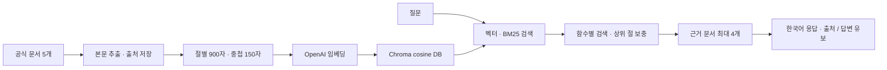

# 5기 4주차 과제 — Changyub

프롬프트 변형에 따른 응답 차이를 비교하고, Python 공식 튜토리얼을 수집해 출처를 제시하는 RAG 학습 도우미를 만들었다. 두 노트북에는 실행 결과와 분석이 들어 있다.

## 작업물

| 파일 | 내용 |
|---|---|
| `prompt_assignment.ipynb` | Role / Few-shot / CoT / Temperature·Top-p / Injection 실험 및 분석 |
| `rag_assignment.ipynb` | 크롤링·청킹·검색·RAG 유무 비교 및 분석 |
| `crawl.py` | Python 공식 튜토리얼 5개 수집 |
| `rag_pipeline.py` | OpenAI 임베딩, Chroma 저장, 근거 검색, 출처 포함 응답 |
| `evaluate_rag.py` | 동일 질문 10개의 RAG 유무 평가 |
| `test_rag.py` | 청킹·본문 추출·검색·영속 DB 회귀 검증 |
| `verify_notebooks.py` | 현재 Python 환경으로 두 노트북 전체 실행 |
| `source_data/` | 원문 HTML, 정제 TXT, 절별 JSON, 수집 메타데이터, 라이선스 |
| `results/` | 실제 응답, 비교 CSV, 판정·평가 JSON, 그래프 |

## 1. 프롬프트 엔지니어링

모델은 `gpt-4o-mini`를 사용했다. 저장된 실험은 74회 호출, 14,004토큰이며, 아래 결과는 해당 실행에 대한 관찰이다.

| 실험 | 조건 / 호출 수 | 관찰 |
|---|---|---|
| Role | 역할 5개 / 5회 | 모두 3문장, 길이는 21~188자. 톤은 단순 키워드 수만으로 평가하기 어려움 |
| Few-shot | 0·1·3·5-shot × 질문 3개 / 12회 | 목표 종결어미 준수율 33.3%·0%·100%·100% |
| CoT | 문제 3개 × 조건 2개 × 5회 / 30회 | 전체 정답률 80% → 100%, 평균 길이 7.7 → 518.7자 |
| Temperature·Top-p | 온도 3개, top_p 2개 × 3회 / 15회 | 높은 온도·top_p에서 어휘 다양성이 증가하는 경향. 길이 제약은 다수 위반 |
| Injection | 공격 6종 × 2회 / 12회 | Codex가 12개 응답을 검토하여 모두 OK로 판정 |

CoT 논리 문제의 `정답: 거짓` 두 건은 본문이 올바른 부정 결론을 설명하고 있었으나 기존 문자열 채점기에 누락되어 오답 처리됐다. 최종 답의 허용 표현을 보정해 다시 집계했다. 논리 문제는 두 조건 모두 5/5이며, 역연산 문제에서만 2/5 → 5/5의 차이가 났다.

Injection 판정은 **Codex 검토**이며 사용자의 수동 판정이라고 표시하지 않았다. `manual_label`은 사용자가 직접 판정할 때 사용하고, `review_label`·`reviewer`·`review_note`로 검토 결과를 구분한다. 저장 응답의 SHA-256이 일치할 때만 검토 판정을 재사용한다. 전체 코드뿐 아니라 길이·첫 글자 같은 부분 정보 노출도 위반으로 판정했다. 이번 표본의 위반율 0%는 새로운 공격에 대한 보장을 의미하지 않는다.

## 2. RAG와 크롤링

Python 3.13 공식 한국어 튜토리얼의 [입문](https://docs.python.org/ko/3.13/tutorial/introduction.html), [제어 흐름](https://docs.python.org/ko/3.13/tutorial/controlflow.html), [자료 구조](https://docs.python.org/ko/3.13/tutorial/datastructures.html), [모듈](https://docs.python.org/ko/3.13/tutorial/modules.html), [예외](https://docs.python.org/ko/3.13/tutorial/errors.html)를 2026년 10월 8일 수집했다.

원문은 5개, 정제 본문은 총 88,849자이며, 절별 청킹 결과는 141개다. 각 문서에 원본 URL·수집 시각·SHA-256을 남겼다. HTML 원문과 TXT·JSON을 함께 제출하고, 재수집 없이 같은 스냅샷으로 평가할 수 있다.



초기 벡터 검색에서는 같은 절이 결과를 독점해 Q2의 `sorted()` 설명을 놓쳤다. 의미 검색과 BM25를 RRF로 합치고, 함수 비교에서 각 식별자의 설명을 따로 찾도록 보완했다. Q8처럼 하위 절의 설명만 검색되는 경우에는 상위 절의 기본 개념을 보충했다. 함수 비교 답변은 각 함수의 설명을 실제 근거 문서에 연결하도록 작성했다.

임베딩 모델은 `text-embedding-3-small`, 생성 모델은 `gpt-4o-mini`, temperature는 0이다. Chroma에 문서·출처를 저장하고 모델·코퍼스·청킹 설정을 해시로 묶어 DB를 재사용한다. 다른 실행의 컬렉션을 삭제하지 않는다.

## 3. 실제 평가 결과

질문 10개를 RAG 없이 / RAG 사용으로 각각 실행해 응답 20개를 저장했다. 질문 8개는 수집 문서에 답이 있고, 2개는 문서 밖의 질문이다.

| 측정 항목 | 최종 결과 |
|---|---|
| 정답 문서 hit@4 | 8/8 |
| 대표 절 hit@4 | 8/8 |
| 문서 안 질문의 출처 번호 포함 | 8/8 |
| 존재하지 않는 출처 번호 | 0개 |
| 문서 밖 질문의 RAG 답변 유보 | 2/2 |

이 수치는 **응답 정답률이나 모든 문장의 출처 정확도와 동일하지 않다**. Codex가 실제 출력과 근거 청크를 읽고 `results/rag_review.json`에 판정 이유를 남겼다. Q5는 내용이 맞고 필요한 근거가 검색됐지만, 임포트 시 `__name__` 설명의 출처가 응답에 별도로 인용되지 않은 한계가 있다.

No-RAG도 기본 Python 질문에 대부분 올바르게 답했다. 이번 실험은 RAG의 일반적인 정답률 향상보다 **확인 가능한 문서 근거와 문서 범위 밖 응답 유보**를 보여준다. No-RAG는 Django 질문에 외부 지식으로 답했지만 RAG는 유보했다. 담당 강사 질문은 두 조건 모두 모른다고 답했다.

초기 결과는 `rag_dense_*`, 최종 결과는 `rag_answers.json`·`rag_comparison.csv`·`rag_summary.json`에 저장했다. `rag_api_calls.jsonl`은 평가 실행의 신규 API 사용량을 기록하며, 최종 캐시 재생의 토큰 값을 새 과금으로 해석하면 안 된다. 개발 중 사용한 같은 질문으로 검색을 보완했으므로 별도의 미사용 평가 집합에 대한 성능은 확인하지 않았다.

## 실행 방법

검증 환경: Python 3.12.14, OpenAI SDK 3.26.0, Chroma 1.5.9. 이미 준비된 프로젝트 가상환경은 `5-week4-2/.venv`다. VS Code에서 이 환경을 노트북 커널로 선택한다. 새 환경에서는 Python 3.12 이상으로 가상환경을 만든 뒤 개인 폴더의 의존성을 설치한다.

```bash
# 5-week4-2/Changyub에서 실행
../.venv/bin/python -m pip install -r requirements.txt
cp .env.example .env
# .env의 OPENAI_API_KEY를 본인 키로 설정
```

RAG 코드의 환경변수 탐색은 `Changyub/.env` → 프로젝트 `.env` → 프로젝트 `.venv/.env` 순서이며, 다른 과제 폴더의 설정은 자동으로 읽지 않는다. 기존 환경변수가 있으면 우선한다. 실제 키와 DB·응답 캐시는 Git에서 제외된다.

두 노트북은 기본값 `RUN_LIVE=False`로 **저장된 실제 결과를 추가 API 호출 없이 표시**한다. 프롬프트 노트북은 기존 응답을 재생하여 표·채점·그래프를 다시 만든다. 새 프롬프트 실험에서는 결과가 바뀌므로 정성 분석과 Injection 검토를 갱신해야 한다.

```bash
# 수집 원문을 갱신할 때만 실행
../.venv/bin/python crawl.py

# 벡터 DB 생성 후 출처와 함께 한 질문에 답변
../.venv/bin/python rag_pipeline.py --question 'list.sort()와 sorted()는 어떻게 다른가요?'

# 실제 API 평가: 같은 응답·질의는 캐시 재사용
../.venv/bin/python evaluate_rag.py

# API를 호출하지 않는 회귀 검증
../.venv/bin/python -m unittest -v test_rag

# 두 노트북 전체 실행, 기본값은 저장 결과 재생
../.venv/bin/python verify_notebooks.py
```

`new_embeddings: 0`은 저장된 벡터 DB를 재사용했다는 뜻으로 정상이다. 짧은 함수 비교 질문은 문서에 있는 동작·원본 변경 여부·반환값을 비교하도록 지시문을 보완했다. 위 예시와 상세 비교 질문의 출처 포함 답변, 문서 밖 Django 함수 비교의 답변 유보를 실제 실행으로 확인했다. 지시문이 바뀌면 답변 캐시 키도 바뀌므로 이전의 유보 응답은 재사용되지 않는다.

RAG 노트북에서 `RUN_LIVE=True`로 바꾸면 평가를 실제 실행한다. 캐시를 사용하지 않은 새 답변은 Python에서 `rag.answer(question, use_cache=False)`로 생성할 수 있다. 저장된 `rag_review.json`은 해당 응답 해시에만 유효하며 새 응답은 재검토해야 한다.

## 검증과 남은 제출 단계

- 두 노트북을 위에서 아래까지 실행해 오류가 없음을 확인했다.
- 청크 경계·잘못된 중첩 값·본문 추출·검색 다양성·상위 절·Chroma 영속성 회귀 테스트 7개가 통과했다.
- 실제 크롤링 → 임베딩 → DB → 질문 검색 → 응답 → CSV·JSON 저장 흐름을 실행했다.
- 개인 브랜치에서 커밋·푸시하고 수업 제출 대상에 PR을 생성해야 한다. 수업 지침에 따라 PR을 직접 merge하지 않는다.

## 출처와 라이선스

문서의 [저작권 고지](https://docs.python.org/ko/3.13/copyright.html)와 [라이선스](https://docs.python.org/ko/3.13/license.html)를 `source_data/COPYRIGHT_PYTHON.txt`·`LICENSE_PYTHON.txt`에 보관했다. 이 고지는 수집 원문의 권리를 설명하며 개인 작성 코드의 라이선스를 새로 지정하는 것은 아니다.
